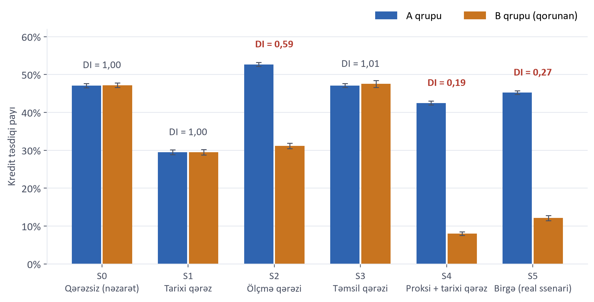
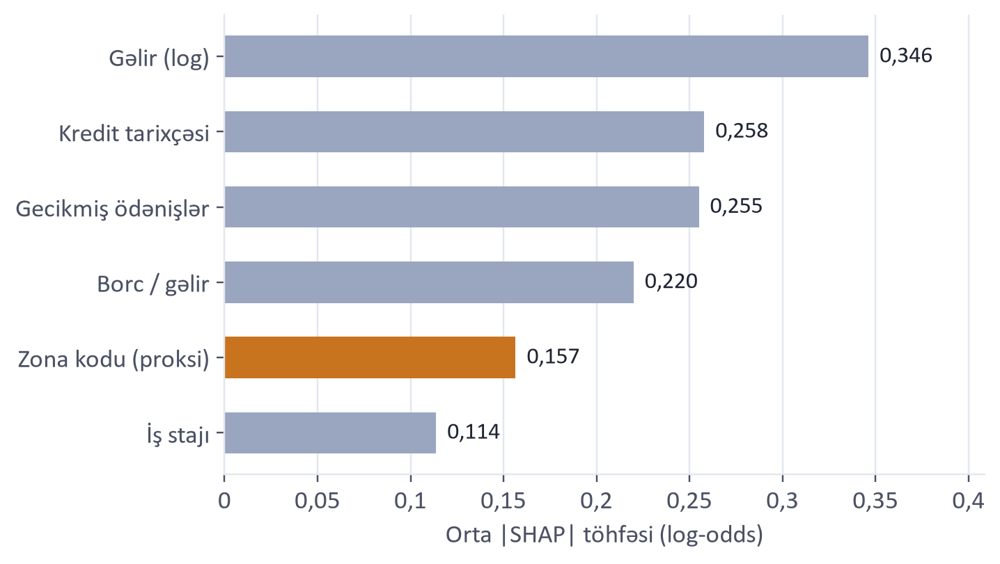
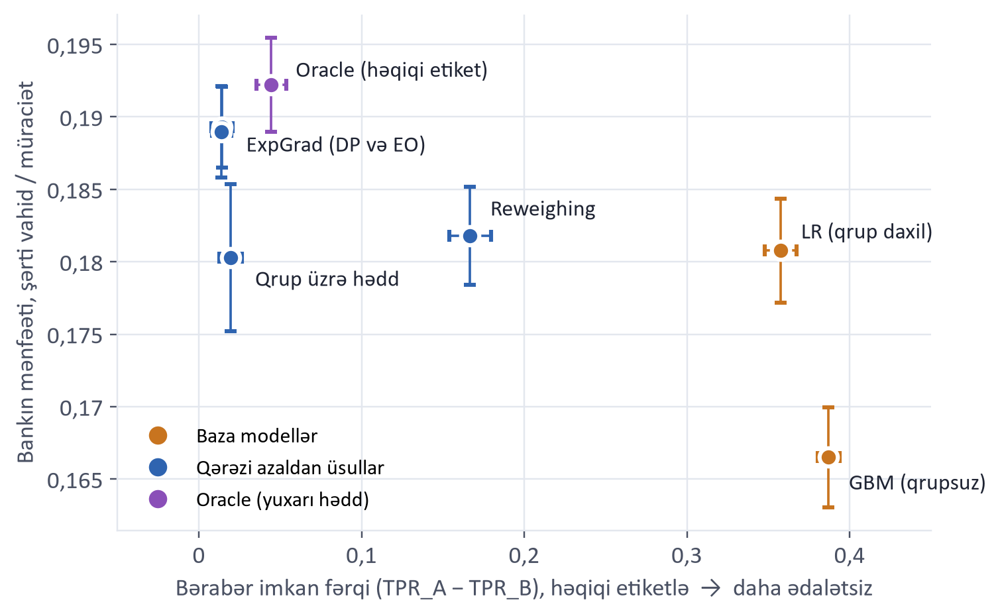
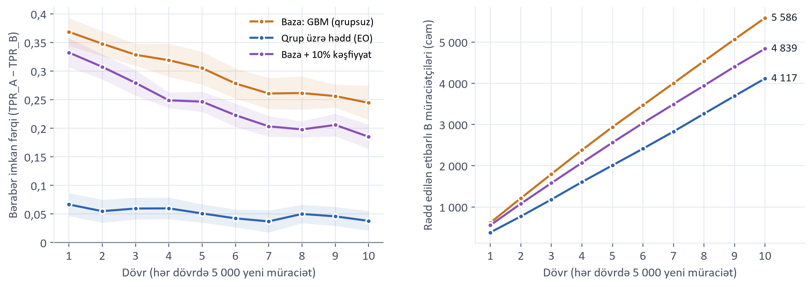
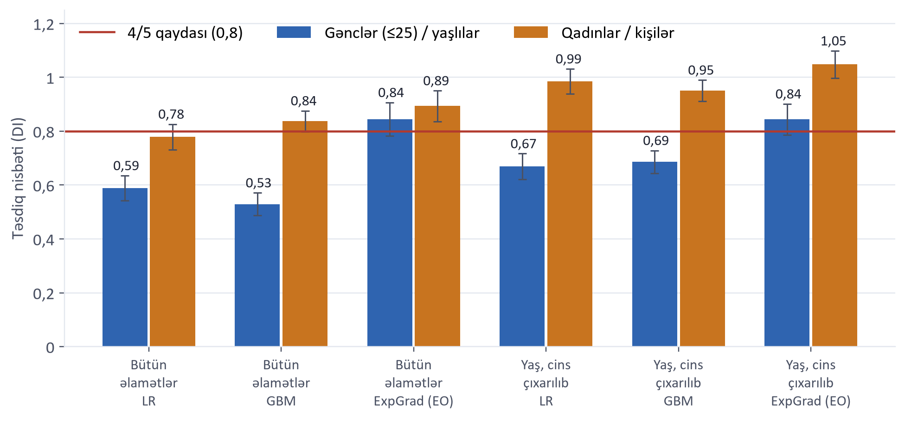

# Kredit sistemində qərəzlilik risklərinin simulyasiyası

**Süni intellektin etik problemləri üzrə tədqiqat** — Azərbaycan Texniki Universiteti,
“Microsoft Azure-da süni intellekt” fənni üzrə sərbəst iş (2026).
Müəllif: Əliyev Orxan, qrup 6223a3.

Bu repozitoriya kredit skorinq modellərində qərəzin **haradan yarandığını**, **nə qədər
insana zərər vurduğunu** və **hansı üsullarla azaldıla biləcəyini** ölçən tam
təkrarlana bilən Python simulyasiyasını və real verilənlər üzərində yoxlamanı ehtiva edir.

## Əsas ideya

Real həyatda rədd edilmiş müraciətçinin krediti qaytarıb-qaytarmayacağını heç vaxt bilmirik.
Simulyasiyada isə bilirik. Simulyatorda:

1. Hər iki qrupun (A və qorunan B) **həqiqi ödəmə qabiliyyəti eyni paylanmadan** gəlir.
   Deməli, qruplar arasında yaranan istənilən fərq real riskdən deyil, verilənlərdəki qərəzdən irəli gəlir.
2. Qərəz mexanizmləri (Suresh & Guttag, 2021 təsnifatı) ayrı-ayrılıqda açılıb-bağlanır:
   **tarixi** (etibarlı B müştəriləri keçmişdə “pis” yazılıb), **ölçmə** (B-nin gəliri sənədlərdə aşağı əks olunur),
   **təmsil** (B azdır) və **proksi** (qrupla korrelyasiyalı, ödəmə ilə əlaqəsiz “zona kodu”).
3. Modellər yalnız bankın real həyatda bildiyi **tarixi etiketlə** (`y_hist`) öyrədilir,
   amma **həqiqi nəticə** (`y_true`) ilə qiymətləndirilir.
4. Qərar qaydası: uğurlu kredit +1, defolt −4 şərti vahid → təsdiq, əgər `P(qaytarır) > 0,8`.

Hər təcrübə 20 müstəqil təkrarla (seed) aparılır; nəticələr orta ± 95% etibarlılıq intervalı ilə verilir.
Bütün parametrlər **şərtidir** və heç bir ölkənin real statistikasını təmsil etmir.

## Əsas nəticələr

| # | Tapıntı | Rəqəm |
|---|---|---|
| 1 | Qərəzsiz verilənlərlə model ədalətlidir | DI = 1,00 (S0) |
| 2 | Tarixi qərəz + proksi ən təhlükəli birləşmədir | DI = 0,19 (S4), 0,27 (S5) |
| 3 | Qrup əlamətini modeldən çıxarmaq kömək etmir — proksi onu əvəz edir | qrup əlamətlərdən AUC = 0,975 ilə bərpa olunur |
| 4 | “Əkiz” testi: eyni insan, yalnız qrup fərqli | etibarlı B üzvlərinin 38,8%-i yalnız qrupuna görə rədd edilir |
| 5 | Fairlearn ExponentiatedGradient (bərabər imkan) | DI 0,27 → 0,97; həqiqi mənfəət 0,167 → 0,189 |
| 6 | “Ədalət bahadır” illüziyası | tarixi etiketlə ölçüləndə mənfəət 0,145 (baza) vs 0,123 (ədalətli) — tərs nəticə |
| 7 | Seçici etiketlər: qərəz özünü yavaş düzəldir | bərabər imkan fərqi 10 dövrdə 0,37 → 0,24 |
| 8 | Real German Credit verilənləri | gənclər (≤25) üçün DI = 0,59 (LR), 4/5 qaydasından aşağı |

Ətraflı rəqəmlər `results/*.json` fayllarındadır, icra jurnalı — `results/run_log.txt`.

### Qərəz mənbələrinin təsiri (S0–S5)


### Proksi effekti: qrupsuz modeldə “zona kodu”nun SHAP töhfəsi


### Qərəzin azaldılması üsulları: ədalət və mənfəət (həqiqi etiketlə)


### Əks-əlaqə dövrəsi


### German Credit (UCI Statlog)


## Eksperimentlər

| Kod | Sual |
|---|---|
| E1 | Hər qərəz mexanizmi nə qədər ədalətsizlik yaradır? (S0–S5 ablasiyası, LR və LightGBM) |
| E2 | Qorunan əlaməti silmək (unawareness) kifayətdirmi? Proksi və SHAP təhlili |
| E3 | “Əkiz” (kontrfaktik) testi: eyni insanlar, yalnız qrup dəyişir |
| E4 | Qərəzin azaldılması: Reweighing, ExponentiatedGradient (DP, EO), qrup üzrə hədd, Oracle |
| E5 | Əks-əlaqə dövrəsi: bank yalnız təsdiq etdiyi müştərilərin nəticəsini görür |
| E6 | Real verilənlər: German Credit (OpenML `credit-g`), yaş və cins üzrə audit, rəsmi xərc matrisi (5:1) |

## İşə salmaq

```bash
python -m venv .venv
.venv/Scripts/activate        # Linux/macOS: source .venv/bin/activate
pip install -r requirements.txt
python -m pytest -q                       # 7 test
python experiments/run_all.py             # tam versiya, ~9 dəqiqə (CPU)
python experiments/run_all.py --quick     # sürətli yoxlama, ~1,5 dəqiqə
python experiments/make_figures.py        # results/figures/*.png
```

German Credit verilənləri ilk icrada OpenML-dən avtomatik yüklənir (`data/` qovluğuna, git-ə daxil deyil).

Sınaqdan keçirildiyi mühit: Python 3.13, NumPy 2.5.5, pandas 3.1.1, scikit-learn 1.9.1,
LightGBM 4.7.0, Fairlearn 0.15.0, Windows 11. GPU və ya bulud resursu tələb olunmur.

## Struktur

```
src/credit_bias/
  simulator.py   # sintetik populyasiya və qərəz mexanizmləri, ssenarilər S0–S5
  metrics.py     # DI, demoqrafik paritet, bərabər imkan, mənfəət, "haqsız imtina / 10 000"
  models.py      # LR, LightGBM, Reweighing, ExponentiatedGradient, qrup üzrə hədd
experiments/
  run_all.py     # E1–E6 → results/*.json
  make_figures.py
tests/test_core.py   # simulyatorun düzgünlüyü və metriklərin Fairlearn ilə uyğunluğu
results/             # JSON nəticələr, jurnal, qrafiklər
```

## Azure ilə əlaqə

Azure Machine Learning-in **Responsible AI** panelində ədalətlilik qiymətləndirməsi Fairlearn
kitabxanası ilə aparılır. Bu işdəki audit (MetricFrame, ExponentiatedGradient) eyni alətlərlə
buludda da təkrarlana bilər.

## Məhdudiyyətlər

- Qərəzin gücü şərtidir; iş mexanizmləri və onların nisbi təsirini göstərir, real bazarın rəqəmlərini yox.
- Hər iki qrupun həqiqi riski eyni qəbul edilib; real həyatda struktur bərabərsizlik real risk fərqi də yarada bilər.
- German Credit kiçik (1000 sətir) və köhnədir (1994); orada həqiqi etiket məlum deyil.
- ExponentiatedGradient təsadüfi qarışıq klassifikatordur; qərarlar sabit `random_state` ilə alınır.
- Qrup üzrə hədd üsulu qərar anında qorunan əlamətdən istifadə edir — bir çox hüquq sistemlərində mübahisəlidir.

## Əsas mənbələr

- Suresh H., Guttag J. A Framework for Understanding Sources of Harm throughout the ML Life Cycle // EAAMO 2021.
- Hardt M., Price E., Srebro N. Equality of Opportunity in Supervised Learning // NeurIPS 2016.
- Kamiran F., Calders T. Data preprocessing techniques for classification without discrimination // KAIS, 2012.
- Agarwal A. və b. A Reductions Approach to Fair Classification // ICML 2018.
- Kusner M. J. və b. Counterfactual Fairness // NeurIPS 2017.
- Lakkaraju H. və b. The Selective Labels Problem // KDD 2017.
- Wick M., Panda S., Tristan J.-B. Unlocking Fairness: a Trade-off Revisited // NeurIPS 2019.
- Bird S. və b. Fairlearn: A toolkit for assessing and improving fairness in AI // Microsoft, MSR-TR-2020-32.
- Hofmann H. Statlog (German Credit Data) // UCI ML Repository, 1994. DOI: 10.24432/C5NC77.

Tam ədəbiyyat siyahısı (25 mənbə) təqdimatın son slaydlarındadır.

## Lisenziya

MIT
